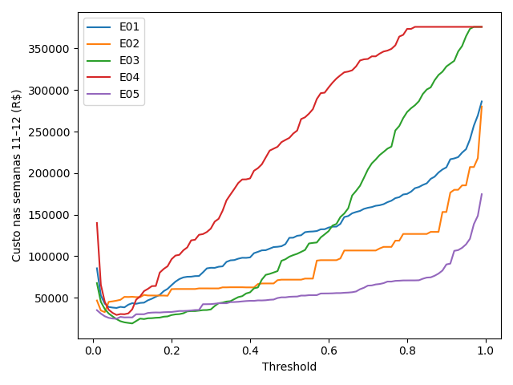

# Comparação inicial e escolha fundamentada

Rodada executada em 06/11/2026, configurações definidas previamente em docs/experimentos.md.

| ID | Algoritmo | Corte | Custo 11–12 (R$) | Recall | Precision | Average precision |
|---|---|---|---|---|---|---|
| E01 | LogisticRegression | 0.06 | 37608.05 | 0.7517 | 0.3299 | 0.6726 |
| E02 | DecisionTreeClassifier | 0.03 | 32578.35 | 0.8583 | 0.3116 | 0.7552 |
| E03 | RandomForestClassifier | 0.10 | 18985.61 | 0.8317 | 0.5097 | 0.8130 |
| E04 | ExtraTreesClassifier | 0.06 | 29196.24 | 0.8250 | 0.3381 | 0.6932 |
| E05 | HistGradientBoostingClassifier | 0.06 | 24587.99 | 0.8400 | 0.5196 | 0.8320 |

## Escolha

Escolha para a próxima etapa: E03 (RandomForestClassifier), corte 0.10, pelo menor custo agregado observado. Custo total de R$ 18985.61 em duas semanas, média de R$ 9492.81/semana. Economia contra a regra Pix: R$ 206364.18 (91.58%). Legítimas bloqueadas: 480 transações (não clientes únicos). Fraude monetária aprovada: R$ 11785.61.

- Semana 11: custo R$ 11019.25; 267 legítimas bloqueadas; fraude perdida R$ 7014.25.
- Semana 12: custo R$ 7966.36; 213 legítimas bloqueadas; fraude perdida R$ 4771.36.

## Baselines agregados do selecionado

- aprovar_tudo: R$ 376035.53.
- regra_pix: R$ 225349.79.
- modelo_05: R$ 99338.94.

## Tentativas e descartes

- E01: não selecionado nesta rodada: custo superior ao escolhido; run `c15eb3a19dd140848563c236fa561f82`; treino 1.43s; inferência de 39.497 transações 0.069s.
- E02: não selecionado nesta rodada: custo superior ao escolhido; run `dda48eedb4c74379b3d32e7cf342db5c`; treino 3.34s; inferência de 39.497 transações 0.061s.
- E03: selecionado pelo menor custo; run `ff48c43154624ec9a1e3d16688909ef3`; treino 65.84s; inferência de 39.497 transações 0.361s.
- E04: não selecionado nesta rodada: custo superior ao escolhido; run `9466c1b470ef444d8ba44a51ba28e397`; treino 27.62s; inferência de 39.497 transações 0.535s.
- E05: não selecionado nesta rodada: custo superior ao escolhido; run `0512c9f8a4ac4307b0a25efc406fd812`; treino 12.11s; inferência de 39.497 transações 0.310s.

Tentativa técnica anterior E01: falha antes do treino por URI de artefatos e codificação do console; registro preservado em tentativa-tecnica-inicial.json. Não é evidência contra o algoritmo.

## Limitações

A seleção e o corte usam as mesmas semanas 11–12: não é teste independente nem garantia futura. A promoção posterior foi aprovada e documentada no registro 009; monitoramento, paridade da API e pacote estão concluídos. O threshold global é uma simplificação exigida; o custo varia com o valor das transações.

## Interpretação e sensibilidade

O boosting E05 teve maior average precision (0,8320 versus 0,8130), mas custo maior (R$ 24.587,99 versus R$ 18.985,61). Seu valor de fraude aprovada foi R$ 17.597,99, contra R$ 11.785,61 da floresta; apesar de bloquear 14 legítimas a menos, essa economia de R$ 210 não compensou a perda monetária adicional. Não escolher pela métrica de ranking isolada.

A Random Forest também teve custo inferior aos demais em cada uma das semanas, sem depender de compensar um resultado ruim em uma semana pelo outro. Isso é evidência observada, não teste estatístico de superioridade futura.

Cortes próximos do selecionado, sem novas configurações treinadas:

|   threshold |   custo |   recall |   precision |   average_precision |   legitimas_bloqueadas |   fraude_perdida |   taxa_bloqueio |
|------------:|--------:|---------:|------------:|--------------------:|-----------------------:|-----------------:|----------------:|
|        0.07 | 21639.8 | 0.858333 |    0.397377 |            0.813039 |                    781 |          9924.75 |       0.0328126 |
|        0.08 | 20316.6 | 0.845    |    0.437446 |            0.813039 |                    652 |         10536.6  |       0.029344  |
|        0.09 | 19604.9 | 0.835    |    0.482659 |            0.813039 |                    537 |         11549.9  |       0.0262805 |
|        0.1  | 18985.6 | 0.831667 |    0.509704 |            0.813039 |                    480 |         11785.6  |       0.0247867 |
|        0.11 | 21875.7 | 0.821667 |    0.530108 |            0.813039 |                    437 |         15320.7  |       0.0235461 |
|        0.12 | 24794.9 | 0.811667 |    0.558486 |            0.813039 |                    385 |         19019.9  |       0.0220776 |
|        0.13 | 24239.9 | 0.811667 |    0.583234 |            0.813039 |                    348 |         19019.9  |       0.0211408 |
